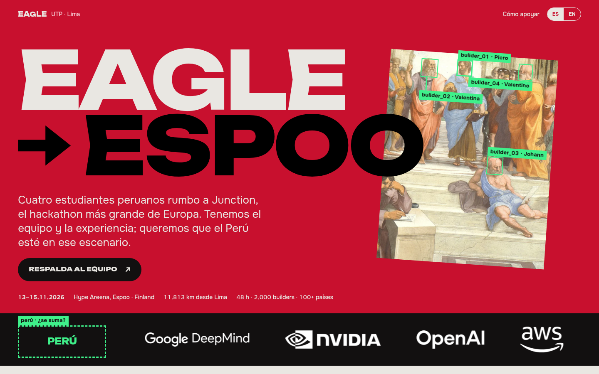
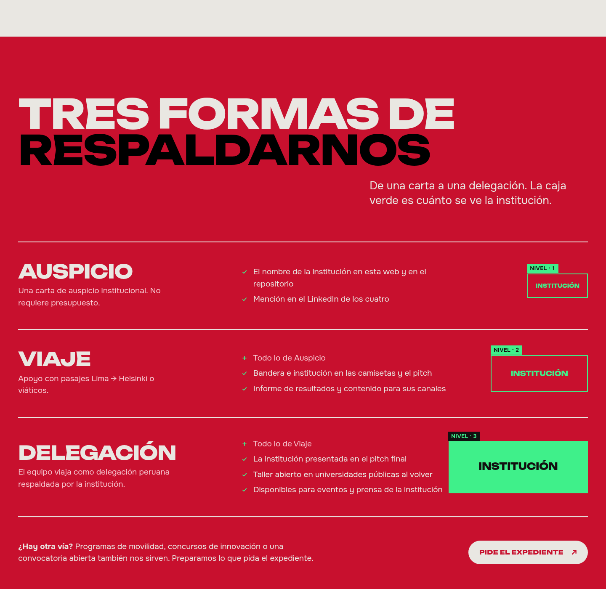
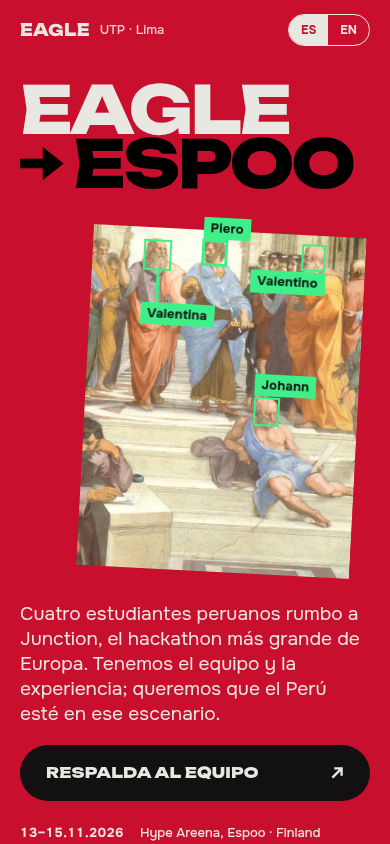

<div align="center">

# PERÚ → ESPOO

**Cuatro estudiantes peruanos rumbo a Junction 2026, el hackathon más grande de Europa. Queremos que el Perú esté en ese escenario.**<br>
<sub>Four Peruvian students heading to Junction 2026, Europe's biggest hackathon · 13–15.11.2026 · Hype Areena, Espoo, Finland</sub>

<br>



<br>

**[Ver la web →](https://eagle-peru.vercel.app)**<br><br>

[Cómo apoyar](#cómo-apoyar) · [Equipo](#el-equipo) · [Correr en local](#correr-en-local) · [Versión UTP](https://github.com/piales00/eagle-junction-2026) · [Versión marcas](https://github.com/piales00/eagle-sponsors)

</div>

---

## La idea

Es la edición para instituciones del Estado peruano de la landing del equipo Eagle. Hay otras dos: una le habla a la [UTP](https://github.com/piales00/eagle-junction-2026) y otra a [empresas](https://github.com/piales00/eagle-sponsors). Esta le habla al país.

Conserva el mismo lenguaje: pinturas del Renacimiento escaneadas por un "detector" de visión por computadora y tipografía pesada de póster. El rojo pasa a ser el de la bandera. En la primera pantalla, junto a Google DeepMind, NVIDIA, OpenAI y AWS, hay un espacio marcado **PERÚ**.

| | |
| :-- | :-- |
| **Para quién** | Instituciones públicas: ministerios, programas de becas y movilidad, agencias de innovación y promoción del país, gobiernos regionales |
| **Qué pide** | Respaldo institucional para competir en Junction 2026 (Espoo, Finlandia) |
| **Qué ofrece** | El Perú en el pitch y en el escenario, un informe de resultados y un taller abierto en universidades públicas al volver |
| **Idiomas** | Español / English, con un selector en la cabecera |

## Cómo apoyar



| Nivel | Qué implica | Qué recibe la institución |
| :-- | :-- | :-- |
| **Auspicio** | Una carta de auspicio institucional, sin presupuesto | Su nombre en la web y en el repo, y una mención en el LinkedIn de los cuatro |
| **Viaje** | Apoyo con pasajes Lima → Helsinki o viáticos | Lo de Auspicio, más la bandera y la institución en camisetas y pitch, y un informe con contenido para sus canales |
| **Delegación** | El equipo viaja como delegación peruana respaldada por la institución | Lo de Viaje, más presencia en el pitch final, un taller en universidades públicas y disponibilidad para sus eventos y prensa |

También sirven las convocatorias abiertas, los programas de movilidad o los concursos de innovación. El expediente con el plan y el presupuesto se envía por correo.

## El equipo

| | Rol | |
| :-- | :-- | :-- |
| **Piero Pérez** | Backend · Multi-agent AI | [LinkedIn](https://www.linkedin.com/in/piero-perez-izquierdo/) · [GitHub](https://github.com/piales00) |
| **Valentina Ayerve** | Agile · Data · IA | [LinkedIn](https://www.linkedin.com/in/valentina-ayerve-devcode) |
| **Johann Diaz** | Data · Business Intelligence | [LinkedIn](https://www.linkedin.com/in/johann-diaz-96137a2a9) |
| **Valentino Llamocca** | Product · Estrategia | [LinkedIn](https://www.linkedin.com/in/valentino-llamocca-barraza-9a279a315) |

Tres becas de excelencia académica UTP, los cuatro en LEAD UTP y un **Top 2 en Stellar Odyssey Perú 2026** con [Masi](https://masiapp.vercel.app).

<div align="center">

</div>

## Correr en local

```bash
git clone https://github.com/piales00/eagle-peru.git
cd eagle-peru
python3 -m http.server 8000   # luego abre http://localhost:8000
```

Es un único `index.html` sin build ni dependencias. Vercel lo sirve tal cual (`npx vercel --prod`).

## Créditos

- **Obras de dominio público** (Wikimedia Commons): Rafael, *La Escuela de Atenas*; Miguel Ángel, *La creación de Adán*; Botticelli, *El nacimiento de Venus*.
- **Inspiración visual:** [2026.hackjunction.com](https://2026.hackjunction.com/).
- **Logos:** los de los partners vienen de la web de Junction 2026 y son de sus dueños. Patrocinan el evento, no a este equipo. La web no usa escudos ni logos oficiales del Estado.

<div align="center">
<br>
<sub>Hecho en Lima, rumbo a Espoo · 11.813 km</sub>
</div>
